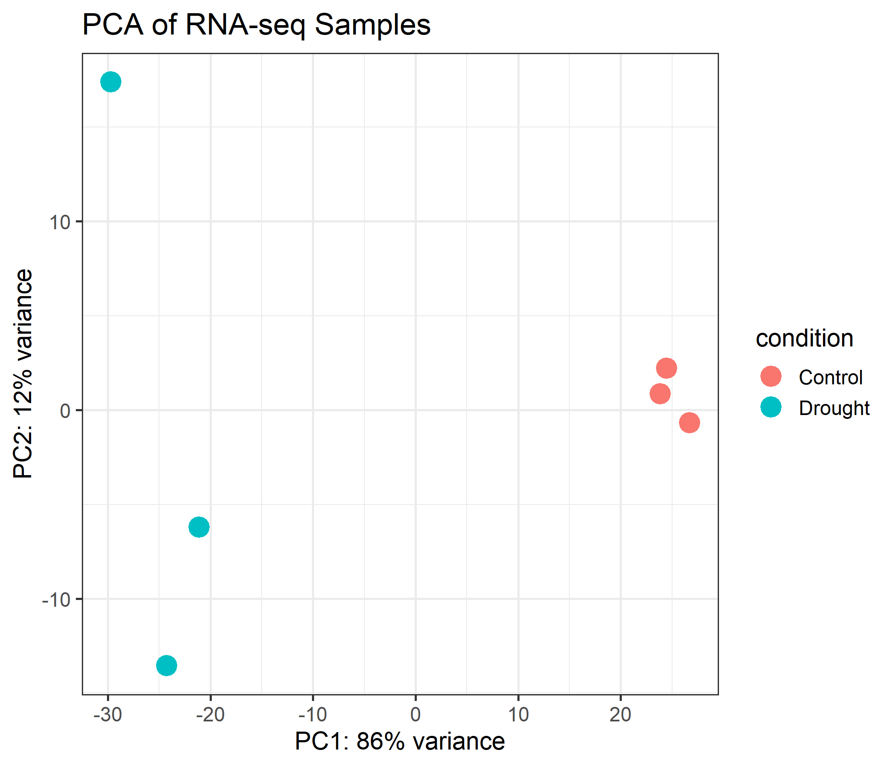
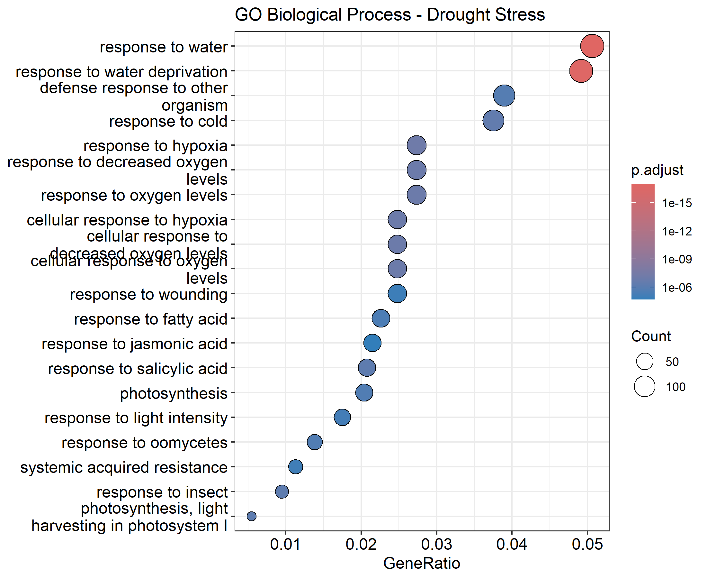
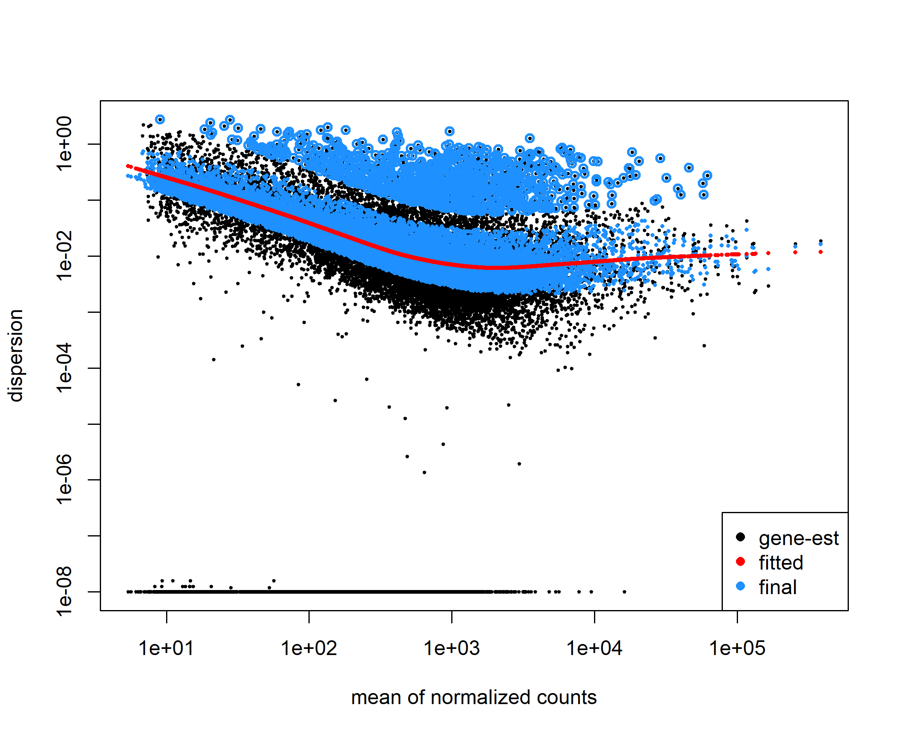
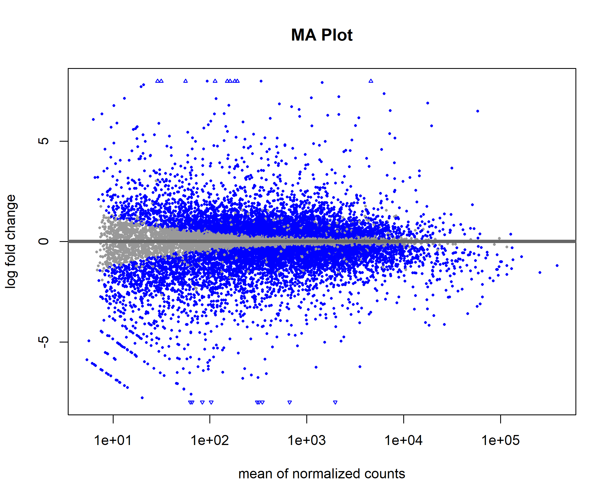
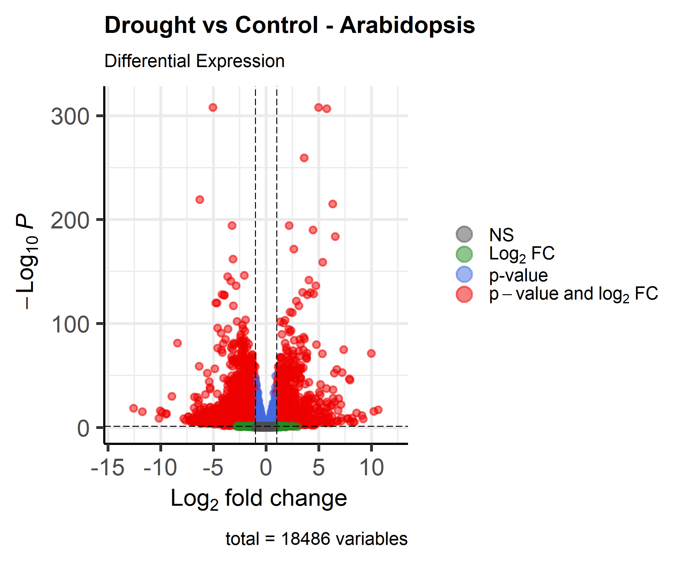
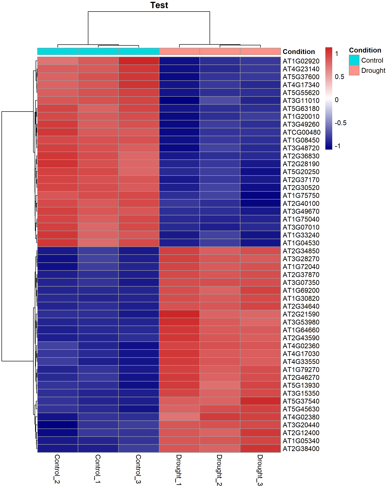
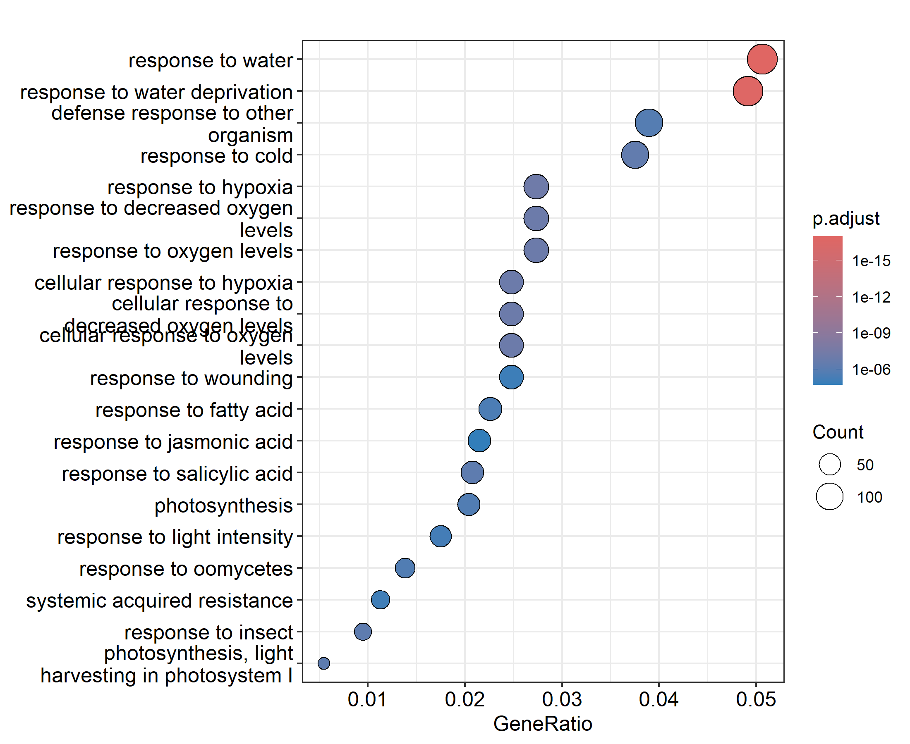
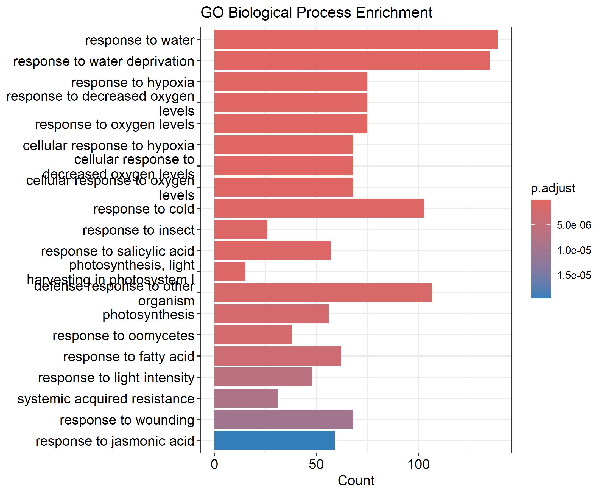
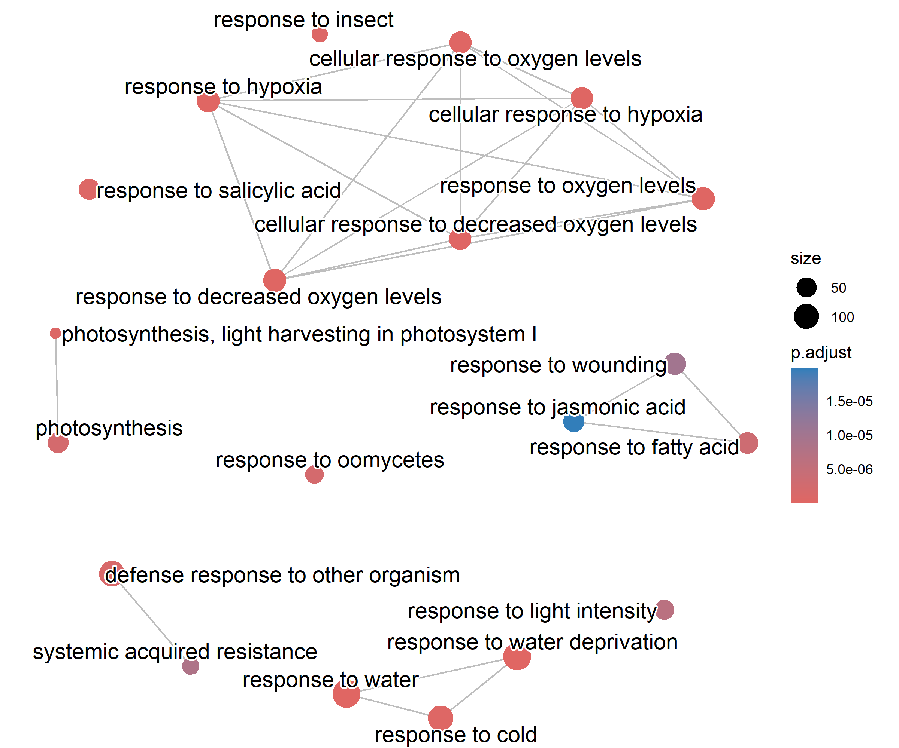
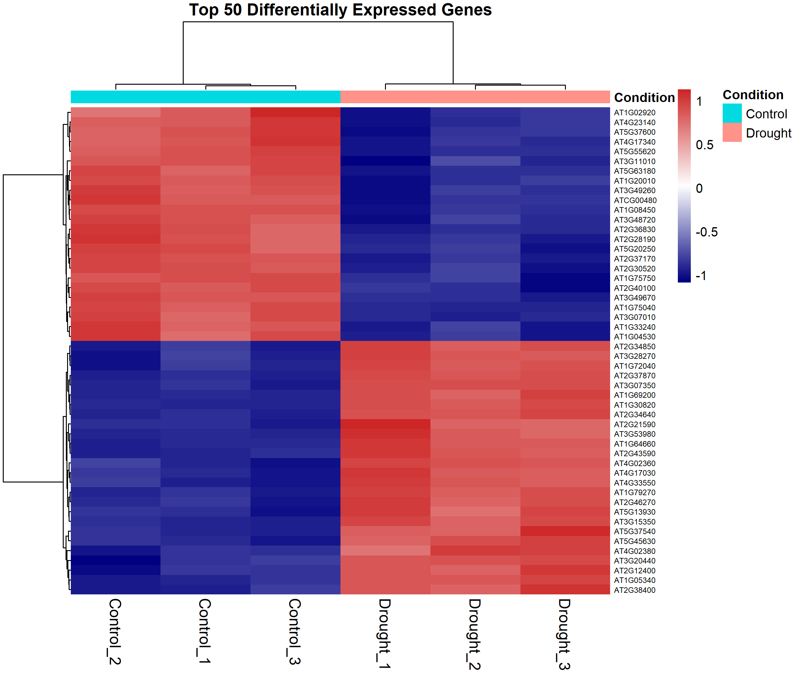

# Arabidopsis Drought Transcriptome Analysis

An end-to-end RNA-seq differential gene expression analysis pipeline for identifying drought-responsive genes in *Arabidopsis thaliana* using HISAT2, featureCounts, DESeq2, and functional enrichment analysis.


# Table of Contents

- [Project Overview](#project-overview)
- [Key Results](#key-results)
- [Biological Background](#biological-background)
- [Project Objectives](#project-objectives)
- [Dataset](#dataset)
  - [Samples](#samples)
- [Workflow](#workflow)
- [Project Structure](#project-structure)
  - [Directory Overview](#directory-overview)
- [Software and Dependencies](#software-and-dependencies)
- [Pipeline Overview](#pipeline-overview)
  - [1. Reference Genome Preparation](#1-reference-genome-preparation)
  - [2. Read Alignment](#2-read-alignment)
  - [3. BAM Processing](#3-bam-processing)
  - [4. Gene Quantification](#4-gene-quantification)
  - [5. Differential Expression Analysis](#5-differential-expression-analysis)
  - [6. Quality Control](#6-quality-control)
  - [7. Differential Expression Visualization](#7-differential-expression-visualization)
  - [8. Functional Enrichment Analysis](#8-functional-enrichment-analysis)
  - [9. Biological Interpretation](#9-biological-interpretation)
- [Results](#results)
  - [Quality Control](#quality-control)
    - [Principal Component Analysis (PCA)](#principal-component-analysis-pca)
    - [Sample Distance Heatmap](#sample-distance-heatmap)
    - [Dispersion Plot](#dispersion-plot)
    - [MA Plot](#ma-plot)
  - [Differential Expression](#differential-expression)
    - [Volcano Plot](#volcano-plot)
    - [Top 50 Differentially Expressed Genes](#top-50-differentially-expressed-genes)
  - [Functional Enrichment](#functional-enrichment)
    - [GO Biological Process Dotplot](#go-biological-process-dotplot)
    - [GO Biological Process Barplot](#go-biological-process-barplot)
    - [GO Enrichment Map](#go-enrichment-map)
    - [Gene–Concept Network (Cnetplot)](#geneconcept-network-cnetplot)
  - [Biological Interpretation](#biological-interpretation)
- [Analysis Summary](#analysis-summary)
  - [Statistical Analysis](#statistical-analysis)
  - [Analysis Statistics](#analysis-statistics)
- [Reproducibility](#reproducibility)
  - [Clone the Repository](#clone-the-repository)
  - [System Requirements](#system-requirements)
  - [Install Required R Packages](#install-required-r-packages)
  - [RNA-seq Workflow](#rna-seq-workflow)
  - [Output](#output)
- [Future Improvements](#future-improvements)
- [References](#references)
- [Author](#author)

---

## Project Overview

This project presents a complete RNA-seq differential gene expression workflow for investigating the transcriptional response of *Arabidopsis thaliana* under drought stress.

The analysis begins with paired-end RNA sequencing data and follows a standard transcriptomics pipeline including read alignment, gene quantification, differential expression analysis, quality control, visualization, and functional enrichment.

The pipeline was implemented using Linux (WSL), HISAT2, SAMtools, featureCounts, and DESeq2 in R, producing publication-quality figures and biologically interpretable results.

---

## Key Results

- Processed 6 paired-end RNA-seq samples (3 Control, 3 Drought)
- Quantified expression for 32,833 genes
- Retained 18,486 genes after filtering
- Identified 3,876 significantly differentially expressed genes
- Generated publication-quality QC visualizations
- GO enrichment identified drought-response, water deprivation and hypoxia pathways

---

## Biological Background

Drought is one of the most significant environmental stresses affecting plant growth, development, and agricultural productivity worldwide. Water deficiency triggers complex physiological and molecular responses that enable plants to conserve water, maintain cellular homeostasis, and improve stress tolerance.

*Arabidopsis thaliana* is widely used as a model organism in plant biology because of its small genome, extensive genetic resources, and well-annotated reference genome. Studying drought-responsive gene expression in *Arabidopsis* provides valuable insights into the molecular mechanisms underlying abiotic stress adaptation and helps identify candidate genes that may improve drought tolerance in economically important crops.

RNA sequencing (RNA-seq) enables genome-wide quantification of gene expression changes between experimental conditions. Differential gene expression analysis identifies genes that are significantly upregulated or downregulated in response to drought stress, while functional enrichment analysis reveals the biological processes associated with these transcriptional changes.

---

## Project Objectives

The objectives of this project are to:

- Perform quality-controlled RNA-seq analysis using an end-to-end transcriptomics workflow.
- Align paired-end RNA-seq reads to the *Arabidopsis thaliana* TAIR10 reference genome using HISAT2.
- Quantify gene-level expression using featureCounts.
- Identify differentially expressed genes (DEGs) using DESeq2 with the Wald statistical test and Benjamini–Hochberg false discovery rate (FDR) correction.
- Evaluate data quality using PCA, sample distance heatmaps, dispersion plots, and MA plots.
- Visualize significant expression changes using volcano plots and heatmaps.
- Perform Gene Ontology (GO) enrichment analysis to identify drought-responsive biological processes.
- Produce publication-quality figures and reproducible analysis scripts suitable for bioinformatics research and portfolio demonstration.

---

## Dataset

| Feature                 | Details                         |
|-------------------------|---------------------------------|
| Organism                | *Arabidopsis thaliana*          |
| Genome Assembly         | TAIR10                          |
| Annotation              | Ensembl Plants Release 60 (GTF) | 
| Sequencing Type         | Paired-end RNA-seq              |
| Experimental Design     | Control vs Drought Stress       |
| Biological Replicates   | 3 Control + 3 Drought           |
| Total Samples           | 6                               |
| Aligner                 | HISAT2                          |
| Gene Quantification     | featureCounts                   |
| Differential Expression | DESeq2 (Wald Test)              |

### Samples

| Sample ID   | Condition |
|-------------|-----------|
| SRR32771550 | Drought   |
| SRR32771551 | Drought   |
| SRR32771552 | Drought   |
| SRR32771559 | Control   |
| SRR32771560 | Control   |
| SRR32771561 | Control   |

---

## Workflow
```text
Raw FASTQ
      │
      ▼
FastQC
      │
      ▼
fastp Trimming
      │
      ▼
FastQC (Trimmed)
      │
      ▼
MultiQC
      │
      ▼
Reference Genome (TAIR10)
      │
      ▼
HISAT2 Alignment
      │
      ▼
SAMtools
(SAM → Sorted BAM → BAM Index)
      │
      ▼
featureCounts
      │
      ▼
Gene Count Matrix
      │
      ▼
DESeq2
      │
      ├──────────────► PCA
      ├──────────────► Sample Distance Heatmap
      ├──────────────► Dispersion Plot
      ├──────────────► MA Plot
      ├──────────────► Volcano Plot
      ├──────────────► Top50 Heatmap
      │
      ▼
GO Enrichment
      │
      ├──────────────► Dotplot
      ├──────────────► Barplot
      ├──────────────► Cnetplot
      └──────────────► Enrichment Map
```
---

## Project Structure

```text
Arabidopsis-Drought-Transcriptome-Analysis/
├── README.md
├── metadata.tsv
│
├── data/
│   ├── raw_fastq/
│   │   ├── SRR32771550_1.fastq
│   │   ├── SRR32771550_2.fastq
│   │   ├── ...
│   │
│   ├── trimmed_fastq/
│   │   ├── SRR32771550_1.trimmed.fastq
│   │   ├── SRR32771550_2.trimmed.fastq
│   │   ├── ...
│   │
│   ├── reference/
│       ├── Arabidopsis_thaliana.TAIR10.dna.toplevel.fa
│       ├── Arabidopsis_thaliana.TAIR10.60.gtf
│       └── index/
│
├── metadata/
│   └── sample_metadata.csv
│
├── scripts/
│   ├── download_fastq.sh
│   ├── run_fastqc.sh
│   ├── run_fastp.sh
│   ├── run_fastqc_trimmed.sh
│   ├── run_multiqc.sh
│   ├── run_multiqc_trimmed.sh
│   ├── run_hisat2.sh
│   ├── run_samtools.sh
│   ├── run_featurecounts.sh
│   └── DESeq2_analysis.R
│
├── results/
│   ├── fastqc/
│   │   ├── raw/
│   │   └── trimmed/
│   │
│   ├── multiqc/
│   │   ├── raw/
│   │   └── trimmed/
│   │
│   ├── fastp/
│   ├── alignment/
│   ├── bam/
│   │    ├── *.sorted.bam
│   │    ├── *.sorted.bam.bai
│   │    └── *_flagstat.txt
│   ├── counts/
│   ├── deseq2/
│   └── figures/
│
├── docs/
│
└── logs/
```

---

### Directory Overview

- **data/** – Raw sequencing reads, trimmed reads, and reference genome files.
- **metadata/** – Sample information used for differential expression analysis.
- **scripts/** – Shell scripts for preprocessing and the R script for DESeq2 analysis.
- **results/** – Intermediate outputs, count matrices, differential expression results, and publication-quality figures.
- **docs/** – Additional documentation and project notes.
- **logs/** – Execution logs generated during the pipeline.

---

## Software and Dependencies

| Software            | Version            | Purpose                |
|---------------------|--------------------|------------------------|
| Ubuntu (WSL)        | 24.04              | Linux environment      |
| HISAT2              | Latest             | Genome alignment       |
| SAMtools            | Latest             | BAM processing         |
| featureCounts       | Subread package    | Gene quantification    |
| R                   | 4.5+               | Statistical analysis   |
| DESeq2              | Bioconductor       | Differential expression|
| ggplot2             | CRAN               | Data visualization     |
| pheatmap            | CRAN               | Heatmaps               |
| EnhancedVolcano     | Bioconductor       | Volcano plots          |
| clusterProfiler     | Bioconductor       | Functional enrichment  |
| enrichplot          | Bioconductor       | GO visualization       |
| org.At.tair.db      | Bioconductor       | Arabidopsis annotation |

---

## Pipeline Overview

## 1. Reference Genome Preparation

The Arabidopsis thaliana TAIR10 reference genome and corresponding GTF annotation were downloaded and indexed using HISAT2.

### Key command

```bash
hisat2-build Arabidopsis.fa TAIR10_index
```

**Output**

- HISAT2 genome index files

---

## 2. Read Alignment

Paired-end RNA-seq reads were aligned to the TAIR10 reference genome using HISAT2.

### Key command

```bash
hisat2 \
-x TAIR10_index \
-1 sample_R1.fastq.gz \
-2 sample_R2.fastq.gz \
-S sample.sam
```

**Output**

- SAM alignment files

---

## 3. BAM Processing

SAM files were converted into compressed BAM format, sorted by genomic coordinates, and indexed using SAMtools.

### Key commands

```bash
samtools view -bS sample.sam > sample.bam

samtools sort sample.bam -o sample.sorted.bam

samtools index sample.sorted.bam
```

**Output**

- Sorted BAM files
- BAM index (.bai)

---

## 4. Gene Quantification

Gene-level read counts were generated using featureCounts.

### Key command

```bash
featureCounts \
-T 8 \
-p \
-a Arabidopsis.gtf \
-o gene_counts.txt \
results/bam/*.sorted.bam
```

**Output**

- gene_counts.txt
- gene_counts.txt.summary

---

## 5. Differential Expression Analysis

Raw gene counts generated by featureCounts were imported into **DESeq2** for statistical analysis.

The following workflow was performed:

- Constructed a DESeq2 dataset using sample metadata.
- Filtered lowly expressed genes by retaining genes with **at least 10 reads in a minimum of 3 samples**.
- Estimated size factors for library normalization.
- Estimated gene-wise dispersion values.
- Fitted negative binomial generalized linear models.
- Performed differential expression testing using the Wald test.
- Adjusted p-values using the Benjamini–Hochberg False Discovery Rate (FDR). The DESeq2 workflow models RNA-seq count data using the negative binomial distribution, enabling robust estimation of biological variability and statistically significant differential expression.

Genes were considered significantly differentially expressed using the following thresholds:

- **Adjusted p-value (FDR) < 0.05**
- **Absolute log2 Fold Change > 1**

The resulting gene lists were divided into:

- Upregulated genes
- Downregulated genes
- All expressed genes

**Output**

- `results/deseq2/all_genes.csv`
- `results/deseq2/significant_genes.csv`
- `results/deseq2/upregulated_genes.csv`
- `results/deseq2/downregulated_genes.csv`

---

## 6. Quality Control

To minimize the dependence of variance on sequencing depth and gene expression levels, raw count data were transformed using the **Variance Stabilizing Transformation (VST)** implemented in DESeq2.

The transformed expression matrix was used for downstream quality assessment and sample clustering.

Quality control visualizations included:

- Principal Component Analysis (PCA)
- Sample Distance Heatmap
- Dispersion Plot
- MA Plot

These analyses confirmed that biological replicates clustered according to their experimental condition and demonstrated good overall data quality.

---

## 7. Differential Expression Visualization

Significant genes were visualized using EnhancedVolcano.

### Main R function

```r
EnhancedVolcano(
    res_df,
    x = "log2FoldChange",
    y = "padj"
)
```

Generated figures

- Volcano Plot
- Top 50 DEGs Heatmap

---

## 8. Functional Enrichment Analysis

Functional enrichment analysis was performed using **Gene Ontology (GO) Biological Process** annotations implemented in **clusterProfiler** to identify biological processes that were significantly overrepresented among the differentially expressed genes.

Significantly enriched GO terms were visualized using multiple complementary plots, including:

- GO Dotplot
- GO Barplot
- GO Enrichment Map (emapplot)
- Gene–Concept Network (cnetplot)

These visualizations provide different perspectives on the functional relationships among enriched biological processes and the genes contributing to them.

KEGG pathway enrichment analysis was also performed using **clusterProfiler**. However, no pathways reached statistical significance after multiple-testing correction. This is a common observation in Arabidopsis transcriptomic datasets and does not affect the biological interpretation supported by the significant GO enrichment results.

## 9. Biological Interpretation

The analysis identified drought-responsive genes associated with:

- Response to water deprivation
- Response to water
- Response to hypoxia
- Response to oxygen levels
- Cellular response to hypoxia

These pathways are consistent with the molecular mechanisms activated during drought stress in *Arabidopsis thaliana*.

---

# Results

## Quality Control

### Principal Component Analysis (PCA)

**Purpose**

Principal Component Analysis (PCA) is used to evaluate overall similarity among samples after variance stabilization. Samples with similar global gene expression profiles cluster together, while biologically distinct conditions separate along the principal components.

**Interpretation**

The PCA plot shows a clear separation between drought-treated and well-watered control samples, indicating that drought induces substantial transcriptomic changes. Biological replicates cluster tightly within each condition, demonstrating high reproducibility and low technical variation.

<p align="center">  </p>

**Key observations**

- Clear separation between Control and Drought samples.
- Replicates cluster closely together.
- Minimal within-group variability.
- Strong biological effect of drought treatment.

---

### Sample Distance Heatmap

**Purpose**

The Sample Distance Heatmap visualizes the pairwise distances between all RNA-seq samples using variance-stabilized expression values. Samples with similar transcriptomic profiles appear closer together and cluster within the same branch of the hierarchical dendrogram.

**Interpretation**

The heatmap demonstrates that biological replicates from the same experimental condition exhibit the smallest pairwise distances, while drought-treated samples are clearly separated from control samples. The hierarchical clustering accurately groups samples according to treatment, indicating excellent reproducibility and strong biological differences between conditions.

<p align="center">  </p>

**Key observations**

- Biological replicates cluster together.
- Drought and Control samples form two distinct clusters.
- Low within-group variability.
- High between-group variability.
- Confirms good sample quality and experimental consistency.

---

### Dispersion Plot

**Purpose**

The dispersion plot illustrates the relationship between gene expression levels and biological variability estimated by DESeq2. Accurate dispersion estimation is essential for reliable statistical testing of differential expression.

**Interpretation**

Most genes closely follow the fitted dispersion trend, indicating that the negative binomial model adequately describes the RNA-seq count data. This suggests stable variance estimation and reliable downstream differential expression analysis.

<p align="center">  </p>

**Key observations**

- Genes follow the fitted dispersion curve.
- Dispersion decreases with increasing expression.
- Appropriate variance modeling.
- Suitable dataset for DESeq2 analysis.

---

### MA Plot

**Purpose**

The MA plot visualizes the relationship between average gene expression (Mean) and log2 fold change (M). Significantly differentially expressed genes are highlighted after statistical testing.

**Interpretation**

Most genes remain centered around a log2 fold change of zero, while a substantial number of genes exhibit significant upregulation or downregulation under drought stress. This pattern indicates a robust transcriptional response while maintaining overall expression stability.

<p align="center">  </p>

**Key observations**

- Majority of genes show stable expression.
- Numerous significantly upregulated genes.
- Numerous significantly downregulated genes.
- Strong differential expression response.

---

## Differential Expression

### Volcano Plot

**Purpose**

The volcano plot simultaneously displays statistical significance and expression fold change, enabling rapid identification of significantly regulated genes.

**Interpretation**

Thousands of genes passed the significance threshold (Adjusted p-value < 0.05 and |log2 Fold Change| > 1). Both strongly induced and strongly repressed genes were identified, highlighting widespread transcriptional remodeling during drought stress.

<p align="center">  </p>

**Key observations**

- Significant genes clearly separated from non-significant genes.
- Large number of upregulated genes.
- Large number of downregulated genes.
- Strong statistical confidence.

---

### Top 50 Differentially Expressed Genes

**Purpose**

The heatmap visualizes normalized expression patterns of the fifty most significant differentially expressed genes after row-wise Z-score scaling.

**Interpretation**

Genes exhibit two major expression clusters corresponding to drought-treated and control samples. Upregulated genes display high expression exclusively under drought conditions, whereas downregulated genes show the opposite pattern. This distinct clustering further validates the differential expression analysis.

<p align="center">  </p>

**Key observations**

- Clear separation between experimental groups.
- Consistent expression among biological replicates.
- Strong induction of drought-responsive genes.
- Distinct repression of control-associated genes.

---

## Functional Enrichment

### GO Biological Process Dotplot

**Purpose**

The GO Biological Process dotplot summarizes significantly enriched biological processes among the differentially expressed genes. Each dot represents an enriched GO term, where dot size corresponds to the number of associated genes and dot color represents statistical significance.

**Interpretation**

GO enrichment analysis revealed strong overrepresentation of drought-associated biological processes. The most significant terms include responses to water deprivation, hypoxia, oxygen availability, and environmental stress, demonstrating coordinated activation of adaptive stress-response pathways.

<p align="center">  </p>

**Key observations**

- Response to water deprivation is highly enriched.
- Hypoxia-related biological processes are significantly overrepresented.
- Larger dots indicate GO terms involving more genes.
- Darker colors represent stronger statistical significance.
- Results agree with known drought stress biology.

---

### GO Biological Process Barplot

**Purpose**

The GO Biological Process barplot summarizes the most significantly enriched biological processes by displaying the number of differentially expressed genes associated with each GO term. This visualization provides a straightforward comparison of the biological processes most strongly represented in the dataset.

<p align="center">

</p>

**Interpretation**

The barplot highlights biological processes related to drought adaptation, including responses to water deprivation, water availability, hypoxia, and oxygen-related stress. The high gene counts observed for these processes indicate that drought stress induces coordinated regulation of numerous genes involved in environmental stress responses.

**Key observations**

- Response to water deprivation is among the most highly enriched biological processes.
- Water- and oxygen-related stress pathways contain a large number of differentially expressed genes.
- Multiple stress-response pathways are simultaneously activated during drought treatment.
- The barplot provides an intuitive comparison of pathway representation based on gene counts.

---

### GO Enrichment Map

**Purpose**

The GO Enrichment Map (emapplot) visualizes relationships among enriched Gene Ontology terms based on the genes they share. Closely connected GO terms are grouped together, allowing functionally related biological processes to be interpreted as coordinated biological modules rather than isolated pathways.

<p align="center">

</p>

**Interpretation**

The enrichment map reveals that drought-responsive biological processes are highly interconnected. GO terms associated with water deprivation, hypoxia, oxygen levels, and stress responses cluster together, indicating that many enriched pathways share common drought-responsive genes. This network organization reflects coordinated activation of multiple biological processes during drought adaptation.

**Key observations**

- Closely connected GO terms share many differentially expressed genes.
- Water deprivation and hypoxia-related pathways form interconnected functional clusters.
- Functionally related biological processes are organized into distinct biological modules.
- The enrichment map simplifies interpretation by highlighting relationships among enriched GO terms rather than viewing each pathway independently.

---

### Gene–Concept Network (Cnetplot)

**Purpose**

The gene–concept network illustrates the relationships between enriched biological processes and the genes contributing to each process.

**Interpretation**

Several drought-responsive genes participate in multiple biological processes, indicating coordinated regulation of interconnected stress-response pathways. Hub genes connecting multiple GO terms may represent important regulators of drought tolerance.

<p align="center">  </p>

**Key observation**

- Multiple genes contribute to more than one GO term.
- Water deprivation and hypoxia pathways share common genes.
- Functional overlap suggests coordinated stress signaling.
- Hub genes represent potential candidates for drought tolerance studies

---

## Biological Interpretation

Gene Ontology enrichment analysis showed that drought stress triggered a coordinated transcriptional response involving water-deficit adaptation and stress signaling pathways.

The most significantly enriched biological processes included:

- **Response to water deprivation (GO:0009414)** – activation of drought-responsive genes that help plants conserve water and adapt to dehydration.
- **Response to water (GO:0009415)** – regulation of genes involved in osmotic balance and water homeostasis.
- **Response to hypoxia (GO:0001666)** – induction of low-oxygen stress response pathways, which are commonly associated with severe drought conditions.
- **Response to decreased oxygen levels (GO:0036293)** – adaptation to altered cellular oxygen availability during stress.
- **Response to oxygen levels (GO:0070482)** – regulation of oxygen-responsive signaling networks.
- **Cellular response to hypoxia (GO:0071456)** – activation of intracellular mechanisms that improve survival under environmental stress.

These enriched biological processes are consistent with previously reported molecular responses of *Arabidopsis thaliana* to drought stress, supporting the biological validity of the differential expression analysis.

---

# Analysis Summary

The RNA-seq differential expression analysis identified substantial transcriptomic changes between drought-treated and control Arabidopsis samples. After quality filtering and statistical testing, thousands of genes were found to be significantly differentially expressed, with strong enrichment of drought-responsive biological processes.

## Statistical Analysis

| Parameter | Value |
|-----------|-------|
| Statistical Model | Negative Binomial GLM |
| Differential Expression Test | Wald Test |
| Multiple Testing Correction | Benjamini–Hochberg FDR |
| Significance Threshold | Adjusted p-value < 0.05 |
| Fold Change Threshold | \|log2FC\| > 1 |

## Analysis Statistics

| Metric                           | Value                            |
|----------------------------------|---------------------------------:|
| Total RNA-seq samples            | 6 (3 Control, 3 Drought)         |
| Genes quantified                 | 32,833                           |
| Genes retained after filtering   | 18,486                           |
| Significant DEGs (padj < 0.05, \|log2FC\| > 1) | 3,876             |
| Upregulated genes                | 1,567                            |
| Downregulated genes              | 2,309                            |
| GO Biological Process enrichment | Significant                      |
| KEGG enrichment                  | No significant pathways detected |

---

# Reproducibility

## Clone the Repository

```bash
git clone https://github.com/<your-username>/Arabidopsis-Drought-Transcriptome-Analysis.git
cd Arabidopsis-Drought-Transcriptome-Analysis
```

## System Requirements

- Ubuntu 24.04 (WSL)
- R (≥ 4.5)
- HISAT2
- SAMtools
- featureCounts (Subread)
- Git

---

## Install Required R Packages

```r
if (!require("BiocManager"))
    install.packages("BiocManager")

BiocManager::install(c(
  "DESeq2",
  "EnhancedVolcano",
  "clusterProfiler",
  "enrichplot",
  "org.At.tair.db"
))

install.packages(c(
  "ggplot2",
  "pheatmap",
  "dplyr",
  "readr",
  "tidyr",
  "tibble",
  "RColorBrewer"
))
```

---

## RNA-seq Workflow

1. Download the reference genome and annotation.
2. Build the HISAT2 genome index.
3. Align paired-end RNA-seq reads using HISAT2.
4. Convert SAM to sorted BAM files using SAMtools.
5. Quantify gene expression using featureCounts.
6. Execute the DESeq2 analysis script.

```bash
Rscript scripts/DESeq2_analysis.R
```

---

## Output

The pipeline generates:

- Differential expression tables
- PCA plot
- Sample distance heatmap
- Dispersion plot
- MA plot
- Volcano plot
- Top 50 DEGs heatmap
- GO Biological Process dotplot
- GO Gene-Concept Network

---

# Future Improvements

Potential extensions of this project include:
- Explore alternative pathway databases (Reactome, MapMan, or updated KEGG annotations).
- Perform Gene Set Enrichment Analysis (GSEA).
- Integrate additional drought RNA-seq datasets for meta-analysis.
- Compare transcriptomic responses across multiple plant species.
- Automate the workflow using Snakemake or Nextflow.
- Containerize the pipeline using Docker.
- Expand quality control reporting with additional MultiQC metrics.
- Develop an interactive visualization dashboard using R Shiny.

---

# References

1. Love MI, Huber W, Anders S. **Moderated estimation of fold change and dispersion for RNA-seq data with DESeq2.** Genome Biology (2014).

2. Kim D, Paggi JM, Park C, Bennett C, Salzberg SL. **Graph-based genome alignment and genotyping with HISAT2.** Nature Biotechnology (2019).

3. Liao Y, Smyth GK, Shi W. **featureCounts: an efficient general-purpose program for assigning sequence reads to genomic features.** Bioinformatics (2014).

4. Yu G, Wang LG, Han Y, He QY. **clusterProfiler: an R package for comparing biological themes among gene clusters.** OMICS (2012).

5. Arabidopsis Information Resource (TAIR): https://www.arabidopsis.org/

6. Ensembl Plants: https://plants.ensembl.org/

---

# Author

**Riya**

Bioinformatics | RNA-seq | NGS | Genomics 
